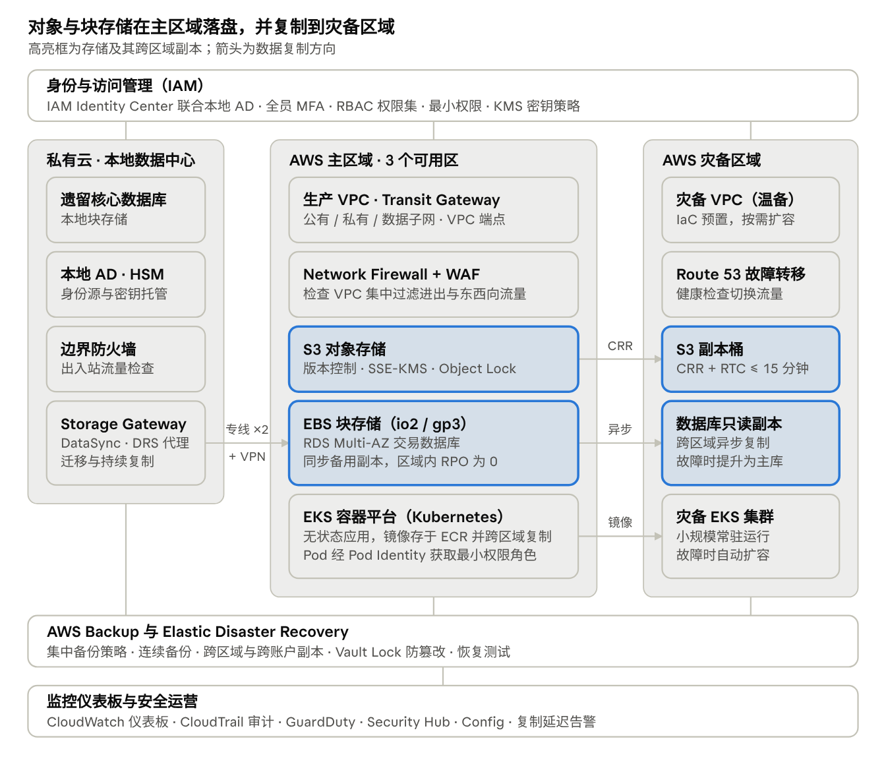

# Apex 金融分析公司 · 混合云存储架构设计（第二部分）

## 设计概览

方案以 AWS 为公有云主平台，保留本地数据中心作为私有云。Amazon S3 承载对象数据，EBS io2 Block Express 承载交易数据库，双区域复制加 AWS Backup 与 Elastic Disaster Recovery 达成 RTO < 1 小时、RPO < 15 分钟。

**表 1** 项目目标与设计决定

| 项目目标 | 设计决定 |
| --- | --- |
| 对象存储（非结构化数据） | Amazon S3，启用版本控制、SSE-KMS 加密和 Object Lock |
| 块存储（结构化数据库） | EBS io2 Block Express 用于交易库，gp3 用于通用负载 |
| 多区域冗余 | 主区域 3 个可用区 + 灾备区域温备；S3 跨区域复制（CRR）加复制时间控制（RTC），数据库跨区域只读副本 |
| RBAC 与 MFA | IAM Identity Center 联合本地 AD，全员强制 MFA，按岗位分配权限集 |
| 自动化灾备与备份 | AWS Backup（集中策略、连续备份、Vault Lock）+ Elastic Disaster Recovery + Route 53 故障转移 |

**设计假设**

- 主区域为 us-east-1，灾备区域为 us-west-2。
- 本地数据中心在迁移期继续运行遗留核心数据库、HSM 和 Active Directory。
- 应用层运行在 Amazon EKS 上，容器保持无状态，业务数据只存放在 RDS 和 S3。
- 成本按 us-east-1 的公开单价计算。

## 架构蓝图

架构分三块：本地私有云、AWS 主区域和 AWS 灾备区域，由统一的身份层、备份层和监控层贯穿。

**图 1** 混合云存储架构

数据经两条专线从本地进入主区域；S3、数据库和容器镜像各走一条链路复制到灾备区域，Route 53 在主区域失效时切换流量。

**表 2** 架构关键元素

| 关键元素 | 组件 | 设计要点 |
| --- | --- | --- |
| 公有云与私有云 | AWS 双区域；本地数据中心 | Direct Connect 双链路接入 Transit Gateway，站点到站点 VPN 作备份 |
| VPC | 生产 VPC、检查 VPC、灾备 VPC | 每个 VPC 跨 3 个可用区，分公有、私有、数据三层子网；数据子网无互联网路由，经 VPC 端点访问 S3 和 KMS |
| 防火墙 | AWS Network Firewall、WAF、安全组、本地边界防火墙 | 所有跨 VPC 和出入站流量经检查 VPC |
| 对象存储 | S3 主桶与副本桶 | 版本控制、SSE-KMS、阻止公共访问；审计桶启用 Object Lock |
| 块存储 | EBS io2 Block Express 与 gp3 | 默认加密；交易库使用 RDS Multi-AZ |
| 复制流程 | DataSync 与 DRS（本地到主区域）；CRR + RTC；数据库跨区域副本 | 复制延迟指标接入告警，阈值按 RPO 设定 |
| IAM 控制 | IAM Identity Center、Organizations 服务控制策略、KMS 密钥策略 | 见下方角色表 |
| 监控仪表板 | CloudWatch 仪表板、CloudTrail、GuardDuty、Security Hub、Config | 仪表板展示复制延迟、备份成功率、RTO/RPO 达标状态；日志汇入独立日志账户 |
| 备份系统 | AWS Backup 保管库（主区域、灾备区域、独立备份账户） | Vault Lock 防删除；每周自动恢复测试 |

### RBAC 角色与 MFA

**表 3** RBAC 角色与 MFA 要求

| 角色 | 权限范围 | MFA 要求 |
| --- | --- | --- |
| 平台管理员 | 网络与计算资源管理；无权读取业务数据和删除备份 | FIDO2 硬件密钥 |
| 数据库管理员 | 数据库运维；生产访问需限时审批 | FIDO2 硬件密钥 |
| 安全审计员 | 全账户只读，可查看日志和审计报告 | 标准 MFA |
| 备份操作员 | 发起备份与恢复；不能修改保管库锁定策略 | 标准 MFA |
| 开发人员 | 仅开发与测试账户；无生产数据访问 | 标准 MFA |

- 所有人员通过 IAM Identity Center 单点登录，不创建长期访问密钥。
- 根账户启用 MFA 并封存，仅用于紧急流程。
- 服务控制策略禁止关闭 CloudTrail、关闭加密和在批准区域之外创建资源。

### EKS、RDS、S3 的 IAM 权限

三项服务都不使用长期密钥：人员通过 IAM Identity Center 权限集访问，应用通过临时角色凭证访问，资源自身再加一层策略兜底。

**表 4** EKS、RDS、S3 的访问控制

| 服务 | 人员访问 | 应用访问 | 资源侧防护 |
| --- | --- | --- | --- |
| EKS | 权限集经 EKS 访问条目映射到集群：平台管理员为集群管理员，开发人员只能在指定命名空间部署或只读 | 每个应用一个 Kubernetes 服务账户，经 EKS Pod Identity 绑定一个专属 IAM 角色；节点角色只保留拉取镜像和加入集群的基础权限 | API 端点设为私有；Kubernetes Secrets 用 KMS 加密；控制面审计日志送入 CloudWatch |
| RDS | 数据库管理员权限集可改实例配置，连接生产库需限时审批；删除实例、关闭加密和关闭备份由服务控制策略禁止 | 应用用 IAM 数据库身份验证（rds-db:connect）换取 15 分钟有效的登录令牌，不保存数据库密码；不适用时改由 Secrets Manager 托管并自动轮换 | 只在数据子网内可达；安全组只放行 EKS Pod 的安全组；存储用 KMS 加密，连接强制 TLS |
| S3 | 按数据分类分桶；安全审计员只读日志桶；任何人员角色都不授予 `s3:*` | 应用角色只允许对指定桶的指定前缀执行 GetObject 和 PutObject；复制角色只含复制所需的动作 | 桶策略拒绝非 TLS 请求、拒绝不经 VPC 端点的访问、拒绝未使用指定 KMS 密钥的上传；账户级阻止公共访问 |

## 存储与服务选择

方案只使用 AWS 一家公有云，原因是其服务集成度高、组件丰富且易用。S3、EBS、RDS、EKS、AWS Backup 和 IAM 由同一套身份、密钥和监控体系贯通，存储、复制、备份和灾备都能用托管服务直接组合，无需自建或跨平台集成。

对象数据用 Amazon S3，数据库用 Amazon EBS，应用运行在 Amazon EKS 上。每项服务内部再按可用区冗余、成本模型和性能吞吐量选定具体的存储类和卷类型。

### 对象存储：S3 存储类对比

**表 5** S3 存储类对比

| 存储类 | 可用区冗余 | 单价（美元/GB/月） | 取回 | 在方案中的用途 |
| --- | --- | --- | --- | --- |
| S3 Standard | 至少 3 个可用区 | 0.023（前 50 TB），0.022（其后 450 TB），0.021（500 TB 以上） | 毫秒级，无取回费 | 30 天内的活跃数据；90 天内的审计日志 |
| S3 Standard-IA | 至少 3 个可用区 | 0.0125 | 毫秒级，按 GB 收取回费 | 30 至 90 天的数据 |
| S3 Glacier Instant Retrieval | 至少 3 个可用区 | 0.004 | 毫秒级，按 GB 收取回费 | 90 天至 1 年的数据 |
| S3 Glacier Deep Archive | 至少 3 个可用区 | 0.00099 | 标准取回约 12 小时 | 1 年以上的长期归档 |

单价见 [S3 定价页](https://aws.amazon.com/s3/pricing/)，存储类说明见 [S3 存储类页](https://aws.amazon.com/s3/storage-classes/)，复制时效见 [S3 RTC 文档](https://docs.aws.amazon.com/us_en/AmazonS3/latest/userguide/replication-time-control.html)。

- **可用区。** 所选四个存储类都跨至少 3 个可用区，设计持久性为 11 个 9。方案不使用单可用区的 One Zone-IA，金融数据不能承受单个机房损毁造成的丢失。
- **性能吞吐量。** 每个前缀每秒至少支持 3,500 次写和 5,500 次读，按前缀并行扩展。Standard、Standard-IA 和 Glacier Instant Retrieval 都是毫秒级访问。
- **成本模型。** S3 按实际用量计费，无需预置容量，也不用选择磁盘类型。生命周期策略把不常访问的数据逐级转入低价存储类，Deep Archive 的单价约为 Standard 的 1/23。
- **RPO 对齐。** RTC 的 15 分钟 SLA 直接覆盖 RPO < 15 分钟的要求，并提供复制延迟指标和超时事件，可直接接入监控告警。
- **数据保护。** Object Lock 提供不可篡改（WORM）保存，用于审计日志和交易凭证；SSE-KMS 按数据分类使用独立密钥。

### 块存储：EBS 卷类型对比

**表 6** EBS 卷类型对比

| 卷类型 | 单卷最大 IOPS | 单卷最大吞吐量 | 卷持久性 | 单价 | 在方案中的用途 |
| --- | --- | --- | --- | --- | --- |
| io2 Block Express | 256,000 | 4,000 MB/s | 99.999% | 0.125 美元/GB/月 + 0.065 美元/IOPS/月（32,000 IOPS 以内，超出部分递减） | 交易数据库 |
| gp3 | 80,000 | 2,000 MB/s | 99.8% 至 99.9% | 0.08 美元/GB/月，含 3,000 IOPS 和 125 MB/s 基线；超出的 IOPS 为 0.005 美元/IOPS/月 | 报表库、EKS 节点和持久卷 |
| st1（吞吐优化 HDD） | 500 | 500 MB/s | 99.8% 至 99.9% | 0.045 美元/GB/月 | 不采用 |

性能上限见 [EBS 卷类型页](https://aws.amazon.com/ebs/volume-types)，单价见 [EBS 定价页](https://aws.amazon.com/ebs/pricing)。

- **可用区。** 一个 EBS 卷只存在于单个可用区，数据在该可用区内自动保存多个副本。跨可用区的冗余由 RDS Multi-AZ 的同步备用副本提供，跨区域的冗余由只读副本和快照复制提供。
- **性能吞吐量。** io2 Block Express 提供亚毫秒延迟，预置 IOPS 在 99.9% 的时间内达标，适合高并发的金融交易写入。st1 单卷只有 500 IOPS，无法支撑交易型数据库的随机读写。
- **成本模型。** 容量与性能分开计价。只有交易库使用 io2；其余负载使用 gp3，每 GB 单价比 io2 低 36%，基线性能已含在容量价内。
- **持久性。** io2 的 99.999% 卷持久性比 gp3 高两个数量级，减少单卷故障触发的恢复。
- **与灾备链路集成。** EBS 快照由 AWS Backup 统一编排，跨区域复制到灾备区域。

### 容器平台：Amazon EKS

**表 7** EKS 平台设计

| 维度 | 设计 |
| --- | --- |
| 可用区 | 控制面由 AWS 托管并跨多个可用区运行；工作节点和 Pod 分布在 3 个可用区 |
| 成本模型 | 控制面 0.10 美元/集群/小时（标准支持版本）；Kubernetes 版本进入延长支持后为 0.60 美元/集群/小时；工作节点按 EC2 实例和 gp3 卷计费；镜像按 ECR 存储量计费 |
| 性能 | 节点组按负载自动伸缩；应用无状态，按副本数水平扩展 |
| 存储 | 节点系统盘和持久卷使用 gp3；业务数据存放在 RDS 和 S3 |

单价见 [EKS 定价页](https://aws.amazon.com/eks/pricing/)。

### 成本模型汇总

**表 8** 成本模型汇总

| 组件 | 计费项 | 单价（us-east-1） |
| --- | --- | --- |
| S3 存储 | 按存储类和容量 | 0.023 至 0.00099 美元/GB/月 |
| S3 跨区域复制 | 副本桶存储 + 跨区域传输 + RTC | 传输 0.02 美元/GB；RTC 0.015 美元/GB |
| EBS io2 Block Express | 容量 + 预置 IOPS | 0.125 美元/GB/月 + 0.065 美元/IOPS/月 |
| EBS gp3 | 容量 + 超基线的 IOPS | 0.08 美元/GB/月 + 0.005 美元/IOPS/月 |
| EKS 控制面 | 每集群每小时 | 0.10 美元；主区域和灾备区域各一个集群，合计约 146 美元/月 |
| EKS 工作节点 | EC2 实例 + gp3 卷 | 按实例规格；灾备集群常驻最小规模 |
| AWS Backup 跨区域副本 | 跨区域传输 + 目标区域存储 | 传输 0.04 美元/GB |

复制与备份的传输单价见 [S3 定价页](https://aws.amazon.com/s3/pricing/) 和 [AWS Backup 定价页](https://aws.amazon.com/backup/pricing/)。

## 冗余与备份

复制负责达成 RTO 和 RPO，备份负责应对误删、逻辑损坏和勒索软件。仅靠定时快照无法满足 15 分钟 RPO，因此每类数据都配有一条持续复制链路。

### 灾备策略：温备与异地双活的成本对比

方案选择温备（Warm Standby）。RTO < 1 小时的要求不需要异地双活那样的即时切换，温备以明显更低的成本满足这一指标，是成本与恢复速度之间的平衡点。

**表 9** 温备与异地双活对比

| 对比项 | 温备（本方案） | 异地双活 |
| --- | --- | --- |
| 灾备区域的计算规模 | 常驻 20% 容量，故障时自动扩容 | 与主区域相同的满规模，长期运行并承担流量 |
| 计算成本 | 约为单区域的 1.2 倍 | 约为单区域的 2 倍 |
| 数据库 | 一个跨区域只读副本，单点写入 | 两个区域同时可写，需要多主架构 |
| 数据复制 | 单向复制，主区域到灾备区域 | 双向同步，跨区域流量加倍，并需处理写入冲突 |
| 存储成本 | 一份完整副本 | 一份完整副本 |
| EKS 控制面 | 两个集群 | 两个集群 |
| 恢复时间 | 数十分钟，满足 RTO < 1 小时 | 接近零 |
| 架构复杂度 | 低 | 高 |

- **成本差异主要在计算层。** 两种策略都要在灾备区域保存完整的数据副本，存储费用和 EKS 控制面费用相同。差别在于异地双活让第二套计算资源全年满负荷运行，温备只为 20% 的容量付费，异地双活的计算成本因此比温备高约 67%。
- **异地双活还有数据库和流量上的额外开销。** 两地同时写入需要多主数据库和双向同步，跨区域传输费用和架构复杂度都高于温备的单向复制。
- **额外投入没有对应收益。** 异地双活多付的费用换来的是把恢复时间从数十分钟压缩到接近零；本项目的指标是 1 小时，温备已经达标。
- **更便宜的策略达不到指标。** 备份还原和冷备需要在故障后临时启动整套环境，恢复时间不稳定，容易超过 1 小时。

### 温备下的数据库处理

交易数据库只在主区域写入，灾备区域保留一个从库和一份事务日志备份。从库保证恢复速度，日志备份保证数据出错时可以回退，两者不能互相替代。

- **区域内高可用。** RDS Multi-AZ 在另一个可用区保留同步备用实例，单个机房故障时自动切换，数据不丢失。
- **跨区域从库。** 灾备区域常驻一个只读副本，异步接收主库的变更，正常情况下落后数秒。区域故障时把它提升为主库，几分钟内完成。所有写入只进主库，避开了异地双活的写入冲突问题。
- **事务日志备份。** AWS Backup 的连续备份保存每日快照和事务日志（MySQL 的 binlog），可恢复到 35 天内的任意时间点。误删或错误更新会被同步到从库，只有日志备份能回到出错之前。
- **成本优化。** 从库可以使用比主库小的实例规格，故障时先升配再接管流量。平时节省实例费用，切换时间增加几分钟到十几分钟，仍在 1 小时以内。
- **切换步骤。** 提升从库为主库，灾备 EKS 集群扩容并连接新主库，Route 53 把流量切到灾备区域。

### 多区域复制

**表 10** 多区域复制链路

| 数据类别 | 区域内冗余 | 跨区域复制 |
| --- | --- | --- |
| S3 对象数据 | Standard 类跨至少 3 个可用区 | CRR + RTC 到灾备区域副本桶；删除标记不复制，副本桶同样启用版本控制和 Object Lock |
| 交易数据库（RDS，io2 卷） | Multi-AZ 同步备用副本，区域内 RPO 为 0 | 跨区域只读副本，异步复制；故障时提升为主库 |
| 本地遗留服务器 | 依赖本地机房自身冗余 | Elastic Disaster Recovery 块级持续复制到灾备区域的低成本暂存卷 |
| KMS 密钥 | 区域服务 | 多区域密钥，灾备区域可直接解密副本 |
| EKS 应用（无状态容器） | 节点与 Pod 分布在 3 个可用区 | ECR 镜像跨区域复制；灾备 EKS 集群用同一套部署配置常驻小规模运行 |

### 生命周期归档策略

**表 11** 生命周期归档策略

| 数据 | 0 至 30 天 | 30 至 90 天 | 90 天至 1 年 | 1 年以上 | 到期 |
| --- | --- | --- | --- | --- | --- |
| 交易凭证与客户文档 | S3 Standard | Standard-IA | Glacier Instant Retrieval | Glacier Deep Archive | 7 年后删除 |
| 审计与访问日志 | S3 Standard | S3 Standard | Glacier Instant Retrieval | Glacier Deep Archive | 保存期满后删除 |
| 非当前版本对象 | S3 Standard | Standard-IA | 删除 |  | 90 天 |

- Deep Archive 取回需数小时，只用于不在 RTO 范围内的历史数据。

### S3 数据归档与备份

S3 不需要选择磁盘，但同样按归档、备份、异地副本和防篡改四层保护。

**表 12** S3 数据保护层

| 保护层 | 使用的服务 | 作用 |
| --- | --- | --- |
| 归档 | S3 生命周期策略，转入 Glacier Instant Retrieval 和 Glacier Deep Archive | 历史数据长期低成本保存 |
| 版本保护 | S3 版本控制 | 误删或误改后可恢复旧版本 |
| 备份 | AWS Backup 对 S3 的连续备份和定期备份 | 35 天内可恢复到任意时间点；备份存放在独立保管库 |
| 异地副本 | S3 跨区域复制 + RTC | 区域故障时由灾备区域的副本桶接管 |
| 防篡改 | S3 Object Lock 和 AWS Backup Vault Lock | 保存期内任何人都无法删除或覆盖，抵御勒索软件 |

### RTO 与 RPO 基准

目标为 RTO < 1 小时、RPO < 15 分钟。每类负载都由一项持续复制服务保证数据新鲜度，再由灾备区域的温备环境保证恢复速度。

**表 13** RTO 与 RPO 预估

| 负载 | 使用的服务 | 预估 RPO | 预估 RTO |
| --- | --- | --- | --- |
| S3 对象数据 | S3 跨区域复制 + 复制时间控制（RTC） | 15 分钟以内 | 15 分钟以内 |
| 交易数据库 | RDS Multi-AZ + 跨区域只读副本 | 5 分钟以内 | 30 分钟以内 |
| EKS 应用 | ECR 跨区域复制 + 灾备 EKS 集群 + Route 53 故障转移 | 无状态，不涉及数据丢失 | 20 分钟以内 |
| 本地遗留服务器 | AWS Elastic Disaster Recovery 持续复制 | 1 分钟以内 | 45 分钟以内 |

S3 的 RPO 由 RTC 的 15 分钟 SLA 保证；数据库的 RPO 来自只读副本的持续同步；RTO 来自灾备区域常驻的温备环境，故障时只需提升副本、扩容集群并切换 DNS。

### AWS Backup 与灾备自动化

备份与恢复由 AWS Backup 统一编排。它与 S3、EBS、RDS 原生集成，一套策略覆盖所有受保护资源，并与 IAM 和 KMS 共用同一套身份与密钥体系。

**表 14** 备份规则

| 备份类型 | 覆盖资源 | 副本去向 |
| --- | --- | --- |
| 连续备份 | RDS、S3 | 主区域保管库，可恢复到任意时间点 |
| 每日备份 | EBS、RDS、EKS 集群 | 跨区域复制到灾备区域，并复制到独立备份账户 |
| 每月备份 | 全部受保护资源 | 独立备份账户，Vault Lock 锁定并长期保留 |

- **策略即代码。** 备份计划通过 AWS Organizations 备份策略下发，按资源标签自动纳管新资源。
- **防篡改。** 备份账户与生产账户隔离，Vault Lock 禁止包括管理员在内的任何人提前删除备份。
- **故障切换自动化。** 灾备环境由基础设施即代码预置；Systems Manager 运行手册编排副本提升、集群扩容和 Route 53 切换。

### EKS 镜像与集群备份

容器化之后，应用的可恢复性取决于镜像、部署配置和集群状态三样东西，各有一项服务负责。

**表 15** EKS 镜像与集群备份

| 保护对象 | 使用的服务 | 说明 |
| --- | --- | --- |
| 容器镜像 | Amazon ECR 跨区域复制 | 镜像推送后自动复制到灾备区域的仓库；开启标签不可变，防止已发布的镜像被覆盖；生命周期策略保留近期版本以便回滚 |
| 部署配置 | Git 仓库（GitOps） | Kubernetes 清单以 Git 为唯一来源，主区域和灾备区域的集群从同一仓库部署 |
| 集群状态与持久卷 | AWS Backup 对 EKS 的备份 | 每日备份集群状态和持久卷，跨区域复制；可按整个集群、单个命名空间或单个持久卷恢复 |
