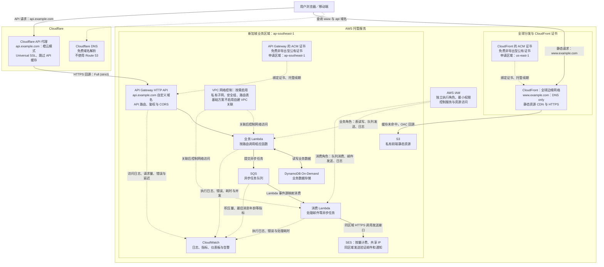

# 第 2 部分：应用设计

## 案例 A

> 一家初创公司希望以最低的前期成本托管一个可扩展的 Web 应用程序。

**云部署模型**：采用公有云，以 AWS 为主要云平台，并使用 Cloudflare 提供 DNS 与 API 反向代理服务。通过按需使用云资源，减少前期基础设施投入及维护成本。

**部署假设**：本方案的 S3、API Gateway、Lambda、SQS、SES、DynamoDB、CloudWatch 等区域性业务服务统一部署在**新加坡 `ap-southeast-1`**。Cloudflare 与 CloudFront 使用全球网络；CloudFront 绑定的 ACM 证书按 AWS 要求在 `us-east-1` 申请。

## 一、案例分析

### 1. 核心需求

根据题目背景，核心需求包括：

1. **尽量压低成本**，适应初创阶段业务量不确定的情况。
2. **减少对自行部署基础设施和维护软件服务的依赖**，降低维护成本。

### 2. 架构设计思路

#### 后台计算：使用 Serverless 服务

Web 应用后台服务使用 Serverless 类型，按实际使用量计费。没有请求时，不产生相应的请求处理费用；相比之下，租用云服务器通常按照使用时间计费，不管有没有请求都会产生费用。

对于初创公司，开始时的业务有极大的不确定性。请求较少时，产生的费用较低；如果业务增速很快，Serverless 也可以随请求量提升而扩展，减少紧急购买服务器、部署应用带来的运维工作。

#### 静态资源：对象存储与 CDN

Web 应用的静态资源直接存放于云厂商的对象存储服务，再加上 CDN 缓存。这样无需专门维护运行 Nginx 或 Apache 的服务器来提供静态资源。

对象存储和 CDN 根据请求、流量及存储容量等使用量收费，无需额外支付静态资源服务器费用。云厂商的对象存储可以承接较大的流量，减少业务突然增长时手动扩展服务器的需要。

#### 数据库：使用 Serverless 数据库

数据库也可以采用 Serverless 类型。按照存储数据量和读写请求量收费，减少额外的数据库服务器费用，以及计算量突增时手动扩容的维护工作。

#### 可观测性：使用云厂商的托管工具

使用云厂商自带的日志收集和分析工具，观察服务运行情况，无需专门部署 ELK 等组件来收集日志，避免增加服务器成本。

#### DNS 与 API 代理：使用 Cloudflare

DNS 使用 Cloudflare 提供的免费域名解析服务。本方案不使用 Amazon Route 53，避免额外的 DNS 托管费用。静态站点和 API 分别使用两个子域名，并按记录配置代理状态：

- **静态站点 `www.example.com`**：CNAME 指向 CloudFront，使用 **DNS only（灰色云朵）**。用户通过 CloudFront 访问 S3 中的前端资源。
- **API `api.example.com`**：CNAME 指向 API Gateway 自定义域名对应的区域端点，开启 **Proxied（橙色云朵）**。API 请求经过 Cloudflare 代理后直接到达 API Gateway，无需经过 CloudFront。

Cloudflare 可以代理 API 请求。对于本方案中的动态 API，配置为跳过缓存；API Gateway 根据 URL 和请求方法将请求路由至相应的 Lambda 函数。由于前端和 API 使用不同源，在 API Gateway 配置 CORS，允许 `https://www.example.com` 发起业务所需的跨源请求。

#### HTTPS 证书：Cloudflare 与 AWS 分别托管

- **用户到 Cloudflare API 代理**：使用 Cloudflare 免费的 Universal SSL 证书。
- **用户到 CloudFront**：使用 AWS Certificate Manager（ACM）提供的免费非导出型公有证书，在 `us-east-1` 申请并绑定 CloudFront。
- **Cloudflare 到 API Gateway**：使用 **Full (strict)** 模式，通过 HTTPS 回源并验证 API Gateway 的证书。为 `api.example.com` 创建 API Gateway 自定义域名、配置 API 映射，并绑定与 API 同区域的免费 ACM 非导出型公有证书；按本方案的区域假设，在 `ap-southeast-1` 申请该证书。

两份 ACM 证书均由 ACM 托管续期。域名验证所需的 DNS 记录添加在 Cloudflare 中，保持 **DNS only** 并保留，以便自动续期；不需要使用 Route 53。

#### 安全机制：IAM 权限管理与 VPC 网络控制

使用 AWS IAM 按最小权限原则管理服务访问。业务 Lambda 和消费 Lambda 分别使用独立的执行角色：业务角色仅允许读写指定的 DynamoDB 表、向指定的 SQS 队列发送消息；消费角色仅授予所需的队列消费与 SES 邮件发送权限。两个角色均配置必要的 CloudWatch 日志写入权限，函数通过角色获取临时凭证，不在代码中保存长期访问密钥。[Lambda 执行角色][lambda-iam]

VPC 作为**按需启用的网络控制**：需要访问私有资源或限制网络出口时，将 Lambda 关联到新加坡区域自建 VPC 的私有子网，使用安全组和路由表控制网络访问。API Gateway、S3、DynamoDB、SQS 和 SES 等托管服务不因此位于该 VPC 内，服务访问权限仍由 IAM 等策略控制。[VPC 说明][vpc-guide]、[Lambda VPC 配置][lambda-vpc]

为保持最低前期成本，当前基础方案不将 Lambda 关联到自建 VPC。后续启用时，需按调用目标配置受支持的 VPC 端点或网络出口；仅关联公共子网不会让 Lambda 获得公网访问能力，NAT Gateway 和接口型 VPC 端点可能增加持续费用。[Lambda VPC 配置][lambda-vpc]、[VPC 定价][vpc-pricing]

## 二、云服务选型

通过以上分析，以 AWS 为例设计一个可行方案。**全部区域性业务服务统一部署在新加坡 `ap-southeast-1`**，CloudFront 使用全球边缘网络。用于 CloudFront 的 ACM 证书仍须在 `us-east-1` 申请。[AWS 区域列表][aws-regions]、[CloudFront 证书要求][cloudfront-acm]。

S3、API Gateway、业务与消费 Lambda、SQS、SES、DynamoDB、CloudWatch 均使用新加坡区域。消费 Lambda 通过同区域的 SES 端点发送邮件，该链路不产生跨区域数据传输费用。[SES 区域端点][ses-regions]、[Lambda 同区域传输说明][lambda-pricing]。

| 功能 | 服务选型 | 区域 | 具体用途 |
| --- | --- | --- | --- |
| DNS 解析 | Cloudflare DNS | 全球 | 免费 DNS 解析，分别配置静态站点和 API 子域名，不使用 Route 53。 |
| API 反向代理 | Cloudflare Proxy | 全球 | 为 `api.example.com` 开启橙色云朵代理，以 Full (strict) 模式回源 API Gateway，并跳过 API 缓存。 |
| 静态资源存储 | Amazon S3 | `ap-southeast-1` | 存储 Web 前端静态页面及其他静态资源。 |
| 静态资源 CDN | Amazon CloudFront | 全球边缘网络 | 对 S3 内容进行分发和加速，静态站点域名采用 DNS only 模式指向 CloudFront。 |
| 用户到 API 代理的 HTTPS | Cloudflare Universal SSL | 全球 | 为用户与 Cloudflare API 代理之间的连接提供免费边缘证书。 |
| AWS 端 HTTPS 证书 | AWS Certificate Manager（ACM） | CloudFront：`us-east-1`；API Gateway：`ap-southeast-1` | 申请免费非导出型公有证书，并托管续期。 |
| API 入口与路由 | Amazon API Gateway HTTP API | `ap-southeast-1` | 接收 Cloudflare 代理转发的 API 请求，根据 URL 和请求方法路由至相应的 Lambda 函数，并配置前端所需的 CORS。 |
| 后台计算 | AWS Lambda | `ap-southeast-1` | 处理 Web API 请求，以及消费队列中的异步任务。 |
| 消息队列 | Amazon SQS | `ap-southeast-1` | 对邮箱验证等异步任务进行排队，解耦业务服务。 |
| 邮件发送 | Amazon SES | `ap-southeast-1` | 发送邮箱验证等邮件，无需自行维护邮件服务器。 |
| 业务数据库 | Amazon DynamoDB On-Demand | `ap-southeast-1` | 存储业务数据，使用按需读写容量模式。 |
| 日志与监控 | Amazon CloudWatch | `ap-southeast-1` | 收集 API Gateway 和 Lambda 日志，监控网关、Lambda、SQS 等服务的运行指标。 |
| 身份与权限控制 | AWS IAM | 全球服务 | 为业务和消费 Lambda 分别配置最小权限执行角色，控制 DynamoDB、SQS、SES 和日志访问。 |
| 网络控制（按需启用） | Amazon VPC | `ap-southeast-1` | 通过私有子网、安全组和路由表控制关联 Lambda 的网络访问；当前低成本基础方案不启用自建 VPC 关联。 |

## 三、架构图

### 图示说明

- **部署区域**：S3、API Gateway、业务与消费 Lambda、SQS、SES、DynamoDB、CloudWatch 均位于新加坡 `ap-southeast-1`；CloudFront 是全球服务，其 ACM 证书位于 `us-east-1`。
- **DNS 解析**：Cloudflare 托管域名解析，按子域名分别设置 DNS only 或 Proxied；本方案不使用 Route 53。
- **静态访问**：`www.example.com` 使用 DNS only 指向 CloudFront。CloudFront 优先从缓存返回静态内容，未命中时通过 OAC 回源至私有 S3。
- **同步 API**：前端访问 `api.example.com`，请求经 Cloudflare 代理直接进入 API Gateway，再由相应的 Lambda 函数处理并读写 DynamoDB。API 流量不经过 CloudFront。
- **HTTPS 证书**：Cloudflare Universal SSL 负责用户到 API 代理的连接；CloudFront 与 API Gateway 各自绑定免费 ACM 非导出型公有证书，后者证书与 API 位于同一区域。Cloudflare 使用 Full (strict) 模式验证 API Gateway 的回源证书。
- **缓存与跨源请求**：动态 API 跳过 Cloudflare 缓存；API Gateway 配置 CORS，允许静态站点的来源、所需方法和请求头。
- **异步任务**：业务 Lambda 将任务写入 SQS，由消费 Lambda 处理；邮件任务通过 SES 发送。
- **可观测性**：CloudWatch 收集网关和 Lambda 的日志与指标，以及 SQS 的队列指标。SQS 任务处理的详细业务日志由消费 Lambda 输出。
- **IAM 权限控制**：业务与消费 Lambda 使用不同的最小权限执行角色，限制其可以访问的资源和执行的操作；IAM 服务权限控制不替代 API 的用户鉴权。
- **VPC 网络控制**：图中的 VPC 为按需启用项，并非当前已部署的网络边界。启用后通过私有子网、安全组和路由表控制关联 Lambda 的网络访问，不将全部 AWS 托管服务放入同一个 VPC。

图中的实线表示业务请求或数据流，虚线表示 DNS 解析、证书配置、监控数据或安全控制关系；响应路径未逐一画出。

## 四、各服务费用

### 1. 计费口径

以下价格于 **2026 年 11 月 3 日**核对，金额均为**美元（USD），不含税**。全部区域性业务服务采用新加坡 `ap-southeast-1`。CloudFront 采用按量计费（Pay-as-you-go），假设静态请求由新加坡所在的亚洲边缘计费组提供服务，不混用固定月费套餐。

表中为未抵扣免费额度的基础费率。多数服务没有固定实例月费，但存储、日志、出网及已创建的监控项目仍可能产生费用。CloudFront 的流量单价取决于实际提供服务的边缘位置，而非 S3 源站所在区域。

| 服务／计费项目 | 本方案采用的按量费率 | 固定费用及说明 |
| --- | --- | --- |
| Cloudflare DNS、基础代理、Universal SSL | Free 计划为 $0/月 | 不购买付费套餐、Workers 或其他附加服务。[Cloudflare 计划][cloudflare-pricing] |
| ACM 公有非导出型证书 | $0 | 用于 CloudFront 和 API Gateway，托管续期；不使用 Private CA 或付费导出型证书。[ACM 定价][acm-pricing] |
| IAM 执行角色与权限策略 | $0 | 基础 IAM 功能不额外收费；不使用付费的 IAM Access Analyzer 分析功能。[IAM 费用说明][iam-guide] |
| VPC 网络控制（按需启用） | VPC 本身无额外基础费用；附加网络组件另计 | 当前不启用自建 VPC 关联、NAT Gateway 或接口型 VPC 端点；后续启用时需另核网络组件费用。[VPC 说明][vpc-guide]、[VPC 定价][vpc-pricing] |
| API Gateway HTTP API | $1.25/100 万次请求，首 3 亿次/月 | 无固定实例月费；大请求按计费大小累加请求单位，公网出网另计。[新加坡价目][price-apigw] |
| Lambda x86 调用 | $0.20/100 万次调用 | 业务 Lambda 与消费 Lambda 分别累计调用次数。[新加坡价目][price-lambda] |
| Lambda x86 计算 | $0.0000166667/GB-s，首 60 亿 GB-s/月 | 计算量为配置内存（GB）×计费时长（秒）；不开启预置并发。[新加坡价目][price-lambda] |
| DynamoDB Standard On-Demand | 写入 $0.71/100 万 WRU；读取 $0.1425/100 万 RRU | 按请求单位而非业务 API 次数计费；项目大小、一致性、事务和索引都会影响用量。[新加坡价目][price-ddb] |
| DynamoDB Standard 存储 | $0.285/GB月，免费存储额度之外 | 不计额外索引、备份、PITR、全局表等可选功能。[新加坡价目][price-ddb] |
| SQS Standard | $0.40/100 万次计费请求，首 1,000 亿次/月 | 发送、接收、删除、空轮询均可能计费；每 64 KiB 负载折算一个请求单位。[新加坡价目][price-sqs] |
| SES 按量发送、共享 IP | $0.10/1,000 个收件人；邮件发送数据按 $0.12/GB 预算 | 采用 à la carte，无固定月费；不购买独享 IP、VDM 或高级计划。新账户需确认未停留在默认 Essentials 计划。[SES 定价][ses-pricing] |
| S3 Standard 存储 | $0.025/GB月，首 50 TB | 根据实际存储量持续计费。[新加坡价目][price-s3] |
| S3 PUT、GET | PUT $0.005/1,000 次；GET $0.0004/1,000 次 | CloudFront 命中缓存时无需向 S3 发起本次回源 GET；S3 到 CloudFront 的数据传输不另收出网费。[新加坡价目][price-s3]、[CloudFront FAQ][cloudfront-faq] |
| CloudFront HTTPS 请求 | $0.012/10,000 次 | 本表采用新加坡所在亚洲边缘计费组；源站区域调整不决定实际边缘计费地点。[按量定价][cloudfront-pricing] |
| CloudFront 公网出网 | $0.12/GB，0–10 TB 用量阶梯的基础单价 | 全球前 1 TB 免费后，该阶梯剩余用量收费；缓存命中不免除 CDN 对用户的出网用量。[按量定价][cloudfront-pricing] |
| CloudWatch Logs Standard | 写入 $0.70/GB；归档 $0.03/压缩 GB月 | 写入与存储分别计费。[新加坡价目][price-cloudwatch] |
| CloudWatch Logs Insights | $0.007/GB 未压缩扫描量 | 查询时间范围、扫描日志量会影响费用。[新加坡价目][price-cloudwatch] |
| CloudWatch 普通仪表板与标准告警 | $3/仪表板月；$0.10/告警指标月 | 免费额度以外计费；仪表板创建后并非按每次查看收费。[CloudWatch 定价][cloudwatch-pricing] |
| API Gateway 至 Cloudflare 的公网出网 | $0.12/GB，0–10 TB 用量阶梯的基础单价 | 扣除可用的共享公网出网免费额度后计费；Cloudflare 的免费代理不会免除 AWS 源站出网费用。[新加坡数据传输价目][price-transfer] |
| Lambda 至 SES 的同区域传输 | $0 | 消费 Lambda 与 SES 均位于新加坡；不计额外的 NAT Gateway、PrivateLink 等未启用网络组件费用。[同区域传输说明][lambda-pricing] |

### 2. 持续免费额度说明

这些额度通常在同一付款账户或组织中共享，不能为每个函数、队列、分发或区域重复抵扣。实际可用额度取决于账户资格及其他项目的使用情况，以 AWS 账户显示为准。

| 服务 | 持续免费额度 | 注意事项 |
| --- | --- | --- |
| Lambda | 100 万次调用/月、400,000 GB-s/月 | 业务与消费函数、适用区域、x86 与 Arm 共用额度。[官方定价][lambda-pricing] |
| DynamoDB Standard | 25 GB 存储/月 | 按区域、按付款账户共享；25 RCU/WCU 的预置容量免费额度不能抵扣 On-Demand 的 RRU/WRU。[官方定价][ddb-pricing] |
| SQS | 100 万次请求/月 | 跨队列、跨适用区域共享；空轮询也消耗额度。[官方定价][sqs-pricing] |
| CloudFront 按量模式 | 1 TB 出网/月、1,000 万次 HTTP/HTTPS 请求/月 | 全球边缘位置与各分发合计使用。[官方说明][cloudfront-faq] |
| CloudWatch Logs | 写入 5 GB/月、归档 5 GB月、Logs Insights 扫描 5 GB/月 | 三类分别计量，均不能按应用或区域重复享用。[官方定价][cloudwatch-pricing] |
| CloudWatch 仪表板与告警 | 3 个每个不超过 50 个指标的普通仪表板；10 个标准告警指标 | 本方案只使用服务默认指标，普通仪表板和直接引用指标的标准告警。[官方定价][cloudwatch-pricing] |
| AWS 区域公网出网 | 100 GB/月 | 跨 AWS 服务和区域共享；与 CloudFront 自身的免费出网额度分开计算，不抵扣跨区域传输。[官方说明][transfer-pricing] |

API Gateway 的新客户免费调用、S3 新用户优惠、AWS 注册赠金等属于账户促销，适用资格和期限应在账户中另行确认。

## 五、价格与配置参考

- [AWS 区域代码][aws-regions]、[SES 区域端点列表][ses-regions]、[CloudFront ACM 证书区域要求][cloudfront-acm]。
- 新加坡区原始价目：[API Gateway][price-apigw]、[Lambda][price-lambda]、[DynamoDB][price-ddb]、[SQS][price-sqs]、[S3][price-s3]、[CloudWatch][price-cloudwatch]、[数据传输][price-transfer]。
- 官方定价说明：[Cloudflare][cloudflare-pricing]、[ACM][acm-pricing]、[Lambda][lambda-pricing]、[DynamoDB][ddb-pricing]、[SQS][sqs-pricing]、[SES][ses-pricing]、[CloudWatch][cloudwatch-pricing]、[CloudFront 按量模式][cloudfront-pricing]、[区域公网出网][transfer-pricing]。
- [CloudFront FAQ：免费额度及 AWS 源站传输][cloudfront-faq]。
- 安全配置：[IAM 与费用说明][iam-guide]、[Lambda 执行角色][lambda-iam]、[VPC 说明][vpc-guide]、[Lambda VPC 配置][lambda-vpc]、[VPC 定价][vpc-pricing]。

[aws-regions]: https://docs.aws.amazon.com/global-infrastructure/latest/regions/aws-regions.html
[ses-regions]: https://docs.aws.amazon.com/general/latest/gr/ses.html
[cloudfront-acm]: https://docs.aws.amazon.com/AmazonCloudFront/latest/DeveloperGuide/cnames-and-https-requirements.html
[cloudflare-pricing]: https://www.cloudflare.com/plans/
[acm-pricing]: https://aws.amazon.com/certificate-manager/pricing/
[price-apigw]: https://pricing.us-east-1.amazonaws.com/offers/v1.0/aws/AmazonApiGateway/current/ap-southeast-1/index.json
[price-lambda]: https://pricing.us-east-1.amazonaws.com/offers/v1.0/aws/AWSLambda/current/ap-southeast-1/index.json
[price-ddb]: https://pricing.us-east-1.amazonaws.com/offers/v1.0/aws/AmazonDynamoDB/current/ap-southeast-1/index.json
[price-sqs]: https://pricing.us-east-1.amazonaws.com/offers/v1.0/aws/AWSQueueService/current/ap-southeast-1/index.json
[price-s3]: https://pricing.us-east-1.amazonaws.com/offers/v1.0/aws/AmazonS3/current/ap-southeast-1/index.json
[price-cloudwatch]: https://pricing.us-east-1.amazonaws.com/offers/v1.0/aws/AmazonCloudWatch/current/ap-southeast-1/index.json
[price-transfer]: https://pricing.us-east-1.amazonaws.com/offers/v1.0/aws/AWSDataTransfer/current/ap-southeast-1/index.json
[lambda-pricing]: https://aws.amazon.com/lambda/pricing/
[ddb-pricing]: https://aws.amazon.com/dynamodb/pricing/
[sqs-pricing]: https://aws.amazon.com/sqs/pricing/
[ses-pricing]: https://aws.amazon.com/ses/pricing/
[cloudwatch-pricing]: https://aws.amazon.com/cloudwatch/pricing/
[cloudfront-pricing]: https://aws.amazon.com/cloudfront/pricing/pay-as-you-go/
[cloudfront-faq]: https://aws.amazon.com/cloudfront/faqs/
[transfer-pricing]: https://aws.amazon.com/ec2/pricing/on-demand/
[iam-guide]: https://docs.aws.amazon.com/IAM/latest/UserGuide/introduction.html
[lambda-iam]: https://docs.aws.amazon.com/lambda/latest/dg/lambda-intro-execution-role.html
[vpc-guide]: https://docs.aws.amazon.com/vpc/latest/userguide/what-is-amazon-vpc.html
[lambda-vpc]: https://docs.aws.amazon.com/lambda/latest/dg/configuration-vpc.html
[vpc-pricing]: https://aws.amazon.com/vpc/pricing/
