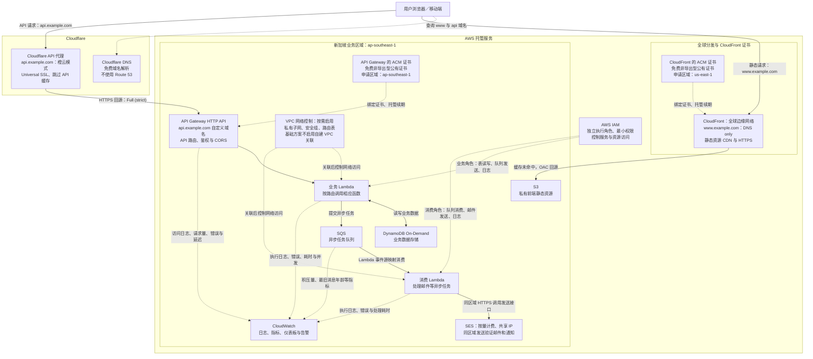

# 第1部分：概念理解

## 云计算架构的核心组成部分

云计算架构由前端、后端、云服务与网络四部分组成。前端位于用户侧，由 GUI 与 dashboard 组成，用户通过手机、笔记本等客户端设备按需访问云服务。后端位于云服务商侧，承载应用、运行时、存储与基础设施，管理软件分配与调度资源，安全工具负责加密与访问控制。云服务以 IaaS、PaaS、SaaS 等交付模型向用户提供计算资源。网络通过 internet 或 intranet 连接前后两端，要求高带宽与低延迟，middleware 协调前后端的通信。

## 三种主要云部署模型的比较

公有云面向公众开放，资源多租户共享，按使用量计费，云服务商托管运维，扩展性强，企业无需前期投入，但是控制力有限。私有云由单一组织独占，组织保持完全控制权。安全与合规水平最高，适合金融、医疗等受监管行业。但是前期投入高，扩展性受专属资源限制，运维由组织自行承担。混合云组合两种以上云基础设施，敏感数据留在私有侧以满足合规要求，波动负载通过云爆发使用公有侧资源，但是跨环境集成引入管理复杂性与安全风险。

## IaaS、PaaS 与 SaaS 的区分

三种服务模型按客户的管理范围区分。使用 IaaS 时，客户获取计算、存储与网络等基础资源，自行管理应用、runtime、中间件与 OS。例如组织用 AWS EC2 部署虚拟机，同时负责 guest OS 更新与安全补丁。使用 PaaS 时，客户只控制部署的应用与托管环境配置，OS 与底层设施由云服务商管理。例如开发团队用 Azure App Service 直接部署代码。使用 SaaS 时，客户直接使用成品应用，仅保留用户级配置。例如员工用 Microsoft 365 在浏览器中处理文档。无论哪种模型，数据与账户管理始终归客户。

# 第 2 部分：应用设计

## 案例 A

> 一家初创公司希望以最低的前期成本托管一个可扩展的 Web 应用程序。

**云部署模型**：采用公有云，以 AWS 为主要云平台，并使用 Cloudflare 提供 DNS 与 API 反向代理服务。通过按需使用云资源，减少前期基础设施投入及维护成本。

**部署假设**：本方案的 S3、API Gateway、Lambda、SQS、SES、DynamoDB、CloudWatch 等区域性业务服务统一部署在**新加坡 `ap-southeast-1`**。Cloudflare 与 CloudFront 使用全球网络；CloudFront 绑定的 ACM 证书按 AWS 要求在 `us-east-1` 申请。

## 一、案例分析

### 1. 核心需求

根据题目背景，核心需求包括：

1. **尽量压低成本**，适应初创阶段业务量不确定的情况。
2. **减少对自行部署基础设施和维护软件服务的依赖**，降低维护成本。

### 2. 架构设计思路

#### 后台计算：使用 Serverless 服务

Web 应用后台服务使用 Serverless 类型，按实际使用量计费。没有请求时，不产生相应的请求处理费用；相比之下，租用云服务器通常按照使用时间计费，不管有没有请求都会产生费用。

对于初创公司，开始时的业务有极大的不确定性。请求较少时，产生的费用较低；如果业务增速很快，Serverless 也可以随请求量提升而扩展，减少紧急购买服务器、部署应用带来的运维工作。

#### 静态资源：对象存储与 CDN

Web 应用的静态资源直接存放于云厂商的对象存储服务，再加上 CDN 缓存。这样无需专门维护运行 Nginx 或 Apache 的服务器来提供静态资源。

对象存储和 CDN 根据请求、流量及存储容量等使用量收费，无需额外支付静态资源服务器费用。云厂商的对象存储可以承接较大的流量，减少业务突然增长时手动扩展服务器的需要。

#### 数据库：使用 Serverless 数据库

数据库也可以采用 Serverless 类型。按照存储数据量和读写请求量收费，减少额外的数据库服务器费用，以及计算量突增时手动扩容的维护工作。

#### 可观测性：使用云厂商的托管工具

使用云厂商自带的日志收集和分析工具，观察服务运行情况，无需专门部署 ELK 等组件来收集日志，避免增加服务器成本。

#### DNS 与 API 代理：使用 Cloudflare

DNS 使用 Cloudflare 提供的免费域名解析服务。本方案不使用 Amazon Route 53，避免额外的 DNS 托管费用。静态站点和 API 分别使用两个子域名，并按记录配置代理状态：

- **静态站点 `www.example.com`**：CNAME 指向 CloudFront，使用 **DNS only（灰色云朵）**。用户通过 CloudFront 访问 S3 中的前端资源。
- **API `api.example.com`**：CNAME 指向 API Gateway 自定义域名对应的区域端点，开启 **Proxied（橙色云朵）**。API 请求经过 Cloudflare 代理后直接到达 API Gateway，无需经过 CloudFront。

Cloudflare 可以代理 API 请求。对于本方案中的动态 API，配置为跳过缓存；API Gateway 根据 URL 和请求方法将请求路由至相应的 Lambda 函数。由于前端和 API 使用不同源，在 API Gateway 配置 CORS，允许 `https://www.example.com` 发起业务所需的跨源请求。

#### HTTPS 证书：Cloudflare 与 AWS 分别托管

- **用户到 Cloudflare API 代理**：使用 Cloudflare 免费的 Universal SSL 证书。
- **用户到 CloudFront**：使用 AWS Certificate Manager（ACM）提供的免费非导出型公有证书，在 `us-east-1` 申请并绑定 CloudFront。
- **Cloudflare 到 API Gateway**：使用 **Full (strict)** 模式，通过 HTTPS 回源并验证 API Gateway 的证书。为 `api.example.com` 创建 API Gateway 自定义域名、配置 API 映射，并绑定与 API 同区域的免费 ACM 非导出型公有证书；按本方案的区域假设，在 `ap-southeast-1` 申请该证书。

两份 ACM 证书均由 ACM 托管续期。域名验证所需的 DNS 记录添加在 Cloudflare 中，保持 **DNS only** 并保留，以便自动续期；不需要使用 Route 53。

#### 安全机制：IAM 权限管理与 VPC 网络控制

使用 AWS IAM 按最小权限原则管理服务访问。业务 Lambda 和消费 Lambda 分别使用独立的执行角色：业务角色仅允许读写指定的 DynamoDB 表、向指定的 SQS 队列发送消息；消费角色仅授予所需的队列消费与 SES 邮件发送权限。两个角色均配置必要的 CloudWatch 日志写入权限，函数通过角色获取临时凭证，不在代码中保存长期访问密钥。[Lambda 执行角色][lambda-iam]

VPC 作为**按需启用的网络控制**：需要访问私有资源或限制网络出口时，将 Lambda 关联到新加坡区域自建 VPC 的私有子网，使用安全组和路由表控制网络访问。API Gateway、S3、DynamoDB、SQS 和 SES 等托管服务不因此位于该 VPC 内，服务访问权限仍由 IAM 等策略控制。[VPC 说明][vpc-guide]、[Lambda VPC 配置][lambda-vpc]

为保持最低前期成本，当前基础方案不将 Lambda 关联到自建 VPC。后续启用时，需按调用目标配置受支持的 VPC 端点或网络出口；仅关联公共子网不会让 Lambda 获得公网访问能力，NAT Gateway 和接口型 VPC 端点可能增加持续费用。[Lambda VPC 配置][lambda-vpc]、[VPC 定价][vpc-pricing]

## 二、云服务选型

通过以上分析，以 AWS 为例设计一个可行方案。**全部区域性业务服务统一部署在新加坡 `ap-southeast-1`**，CloudFront 使用全球边缘网络。用于 CloudFront 的 ACM 证书仍须在 `us-east-1` 申请。[AWS 区域列表][aws-regions]、[CloudFront 证书要求][cloudfront-acm]。

S3、API Gateway、业务与消费 Lambda、SQS、SES、DynamoDB、CloudWatch 均使用新加坡区域。消费 Lambda 通过同区域的 SES 端点发送邮件，该链路不产生跨区域数据传输费用。[SES 区域端点][ses-regions]、[Lambda 同区域传输说明][lambda-pricing]。

| 功能 | 服务选型 | 区域 | 具体用途 |
| --- | --- | --- | --- |
| DNS 解析 | Cloudflare DNS | 全球 | 免费 DNS 解析，分别配置静态站点和 API 子域名，不使用 Route 53。 |
| API 反向代理 | Cloudflare Proxy | 全球 | 为 `api.example.com` 开启橙色云朵代理，以 Full (strict) 模式回源 API Gateway，并跳过 API 缓存。 |
| 静态资源存储 | Amazon S3 | `ap-southeast-1` | 存储 Web 前端静态页面及其他静态资源。 |
| 静态资源 CDN | Amazon CloudFront | 全球边缘网络 | 对 S3 内容进行分发和加速，静态站点域名采用 DNS only 模式指向 CloudFront。 |
| 用户到 API 代理的 HTTPS | Cloudflare Universal SSL | 全球 | 为用户与 Cloudflare API 代理之间的连接提供免费边缘证书。 |
| AWS 端 HTTPS 证书 | AWS Certificate Manager（ACM） | CloudFront：`us-east-1`；API Gateway：`ap-southeast-1` | 申请免费非导出型公有证书，并托管续期。 |
| API 入口与路由 | Amazon API Gateway HTTP API | `ap-southeast-1` | 接收 Cloudflare 代理转发的 API 请求，根据 URL 和请求方法路由至相应的 Lambda 函数，并配置前端所需的 CORS。 |
| 后台计算 | AWS Lambda | `ap-southeast-1` | 处理 Web API 请求，以及消费队列中的异步任务。 |
| 消息队列 | Amazon SQS | `ap-southeast-1` | 对邮箱验证等异步任务进行排队，解耦业务服务。 |
| 邮件发送 | Amazon SES | `ap-southeast-1` | 发送邮箱验证等邮件，无需自行维护邮件服务器。 |
| 业务数据库 | Amazon DynamoDB On-Demand | `ap-southeast-1` | 存储业务数据，使用按需读写容量模式。 |
| 日志与监控 | Amazon CloudWatch | `ap-southeast-1` | 收集 API Gateway 和 Lambda 日志，监控网关、Lambda、SQS 等服务的运行指标。 |
| 身份与权限控制 | AWS IAM | 全球服务 | 为业务和消费 Lambda 分别配置最小权限执行角色，控制 DynamoDB、SQS、SES 和日志访问。 |
| 网络控制（按需启用） | Amazon VPC | `ap-southeast-1` | 通过私有子网、安全组和路由表控制关联 Lambda 的网络访问；当前低成本基础方案不启用自建 VPC 关联。 |

## 三、架构图

### 图示说明

- **部署区域**：S3、API Gateway、业务与消费 Lambda、SQS、SES、DynamoDB、CloudWatch 均位于新加坡 `ap-southeast-1`；CloudFront 是全球服务，其 ACM 证书位于 `us-east-1`。
- **DNS 解析**：Cloudflare 托管域名解析，按子域名分别设置 DNS only 或 Proxied；本方案不使用 Route 53。
- **静态访问**：`www.example.com` 使用 DNS only 指向 CloudFront。CloudFront 优先从缓存返回静态内容，未命中时通过 OAC 回源至私有 S3。
- **同步 API**：前端访问 `api.example.com`，请求经 Cloudflare 代理直接进入 API Gateway，再由相应的 Lambda 函数处理并读写 DynamoDB。API 流量不经过 CloudFront。
- **HTTPS 证书**：Cloudflare Universal SSL 负责用户到 API 代理的连接；CloudFront 与 API Gateway 各自绑定免费 ACM 非导出型公有证书，后者证书与 API 位于同一区域。Cloudflare 使用 Full (strict) 模式验证 API Gateway 的回源证书。
- **缓存与跨源请求**：动态 API 跳过 Cloudflare 缓存；API Gateway 配置 CORS，允许静态站点的来源、所需方法和请求头。
- **异步任务**：业务 Lambda 将任务写入 SQS，由消费 Lambda 处理；邮件任务通过 SES 发送。
- **可观测性**：CloudWatch 收集网关和 Lambda 的日志与指标，以及 SQS 的队列指标。SQS 任务处理的详细业务日志由消费 Lambda 输出。
- **IAM 权限控制**：业务与消费 Lambda 使用不同的最小权限执行角色，限制其可以访问的资源和执行的操作；IAM 服务权限控制不替代 API 的用户鉴权。
- **VPC 网络控制**：图中的 VPC 为按需启用项，并非当前已部署的网络边界。启用后通过私有子网、安全组和路由表控制关联 Lambda 的网络访问，不将全部 AWS 托管服务放入同一个 VPC。

图中的实线表示业务请求或数据流，虚线表示 DNS 解析、证书配置、监控数据或安全控制关系；响应路径未逐一画出。

## 四、反思

### 1. 可靠性

本方案的可靠性主要依靠 AWS 托管的 Serverless 服务。AWS 负责维护底层运行基础设施，Lambda 提供跨可用区运行能力，减少自行维护服务器带来的故障风险。SQS 可以暂存待处理的异步任务，CloudWatch 用于监控运行情况、发现异常。不过，Serverless 并不意味着业务不会发生故障，仍需合理配置错误处理与监控。[Lambda 可靠性说明][lambda-resilience]、[SQS 服务说明][sqs-overview]

### 2. 可扩展性

架构中的 SQS 将异步任务的提交与处理解耦。未来增加更多任务类型时，可以新增 SQS 队列和对应的消费 Lambda，由业务代码将不同类型的任务发送到相应队列，实现任务分发。不同任务可以独立调整处理能力，减少新增功能对现有业务流程的影响。[SQS 服务说明][sqs-overview]

### 3. 安全性

安全性主要通过 AWS IAM 的权限管理来支持。除现有的 Lambda 执行角色外，后续公司成员需要使用不同模块时，可以按职责设置独立的 IAM 角色，并授权相应成员切换使用，只授予其工作所需的 AWS 资源权限，避免所有成员共用管理员权限。成员使用的角色与 Lambda 执行角色分开管理。这里的 IAM 权限主要针对 AWS 资源的管理和访问，应用内部的用户功能权限仍需由应用自身实现鉴权。[IAM 角色使用说明][iam-switch-role]

[aws-regions]: https://docs.aws.amazon.com/global-infrastructure/latest/regions/aws-regions.html
[ses-regions]: https://docs.aws.amazon.com/general/latest/gr/ses.html
[cloudfront-acm]: https://docs.aws.amazon.com/AmazonCloudFront/latest/DeveloperGuide/cnames-and-https-requirements.html
[lambda-pricing]: https://aws.amazon.com/lambda/pricing/
[lambda-iam]: https://docs.aws.amazon.com/lambda/latest/dg/lambda-intro-execution-role.html
[vpc-guide]: https://docs.aws.amazon.com/vpc/latest/userguide/what-is-amazon-vpc.html
[lambda-vpc]: https://docs.aws.amazon.com/lambda/latest/dg/configuration-vpc.html
[vpc-pricing]: https://aws.amazon.com/vpc/pricing/
[lambda-resilience]: https://docs.aws.amazon.com/lambda/latest/dg/security-resilience.html
[sqs-overview]: https://docs.aws.amazon.com/AWSSimpleQueueService/latest/SQSDeveloperGuide/welcome.html
[iam-switch-role]: https://docs.aws.amazon.com/IAM/latest/UserGuide/id_roles_use_switch-role-console.html
